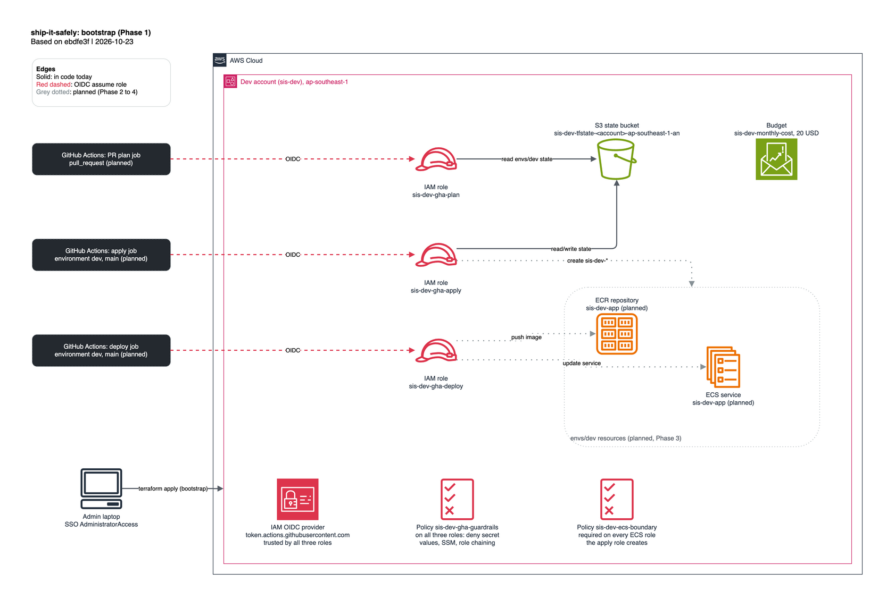

# bootstrap

Runs **once per AWS account**, locally, with your SSO admin login. It creates what GitHub Actions and
Terraform need before any app infrastructure exists. Design and decisions: [ADR 0002](../../../docs/adr/0002-phase-1-bootstrap-dev.md).

| Resource | Name | Notes |
|---|---|---|
| State bucket | `sis-dev-tfstate-<account_id>-ap-southeast-1-an` | Account-regional namespace, versioned, SSE-S3, public access blocked, TLS only |
| GitHub OIDC provider | `token.actions.githubusercontent.com` | Audience `sts.amazonaws.com` |
| Plan role | `sis-dev-gha-plan` | PR jobs only; `ReadOnlyAccess` + `envs/dev` state read + lock file |
| Apply role | `sis-dev-gha-apply` | `environment: dev` on `main`; only the `sis-dev-*` resources of `modules/app-ecs` |
| Deploy role | `sis-dev-gha-deploy` | `environment: dev` on `main`; one ECR repo, one ECS service |
| ECS role boundary | `sis-dev-ecs-boundary` | Every ECS role the apply role creates must carry it |
| Guardrails | `sis-dev-gha-guardrails` | On all three roles: deny secret values, SSM parameters, role chaining, bootstrap state |
| Budget | `sis-dev-monthly-cost` | 20 USD/month, email at 80% actual |

## Trust conditions

All `StringEquals`:

| Role | `sub` | Also checked |
|---|---|---|
| plan | `repo:OWNER@OWNER_ID/REPO@REPO_ID:pull_request` | `aud`, `repository_id`, `repository_owner_id` |
| apply, deploy | `repo:OWNER@OWNER_ID/REPO@REPO_ID:environment:dev` | the same, plus `ref = refs/heads/main` |

The `sub` uses GitHub's immutable format with numeric IDs, so a renamed or re-created repo with the same name
cannot assume the roles. The PR plan job must not set `environment:`, or its `sub` stops being `pull_request`.

## Name contract

The apply and deploy roles are scoped by name and tag before `envs/dev` exists, so `envs/dev` must use the
names in the `resource_names` output and the provider `default_tags` (`Project`, `Env`, `ManagedBy`).
Security group rules must be standalone `aws_vpc_security_group_ingress_rule` / `egress_rule` resources, so
they carry the tags the apply role checks.

## Inputs

`accounts/dev.tfvars` is gitignored: copy `accounts/dev.tfvars.example` and fill in the account ID, budget
email and the two GitHub IDs. No account ID is committed (ADR 0001, D2); a pre-commit hook rejects a bare
12-digit number in `.tf`, `.hcl` and `.tfvars.example` files under `infra/`.

## Run it (you, never Claude: NFR-9)

1. Fill in `dev.tfvars`, `aws sso login --profile sis-dev-admin`, and check that
   `aws sts get-caller-identity` shows the dev account.
2. First apply on local state, using a gitignored `backend_override.tf` with `backend "local" {}`.
3. Delete the override and move state into the bucket:
   `terraform init -migrate-state -backend-config="bucket=<state_bucket_name>"`. A second plan shows no changes.
4. Create GitHub environment `dev` (you as required reviewer, `main` only) and the variables from the
   outputs. Environment `dev`: `AWS_REGION`, `AWS_APPLY_ROLE_ARN`, `AWS_DEPLOY_ROLE_ARN`, `TF_STATE_BUCKET`,
   `AWS_ACCOUNT_ID`. Repo: `AWS_REGION`, `AWS_PLAN_ROLE_ARN_DEV`, `TF_STATE_BUCKET_DEV`, `AWS_ACCOUNT_ID_DEV`.
   These are variables, never secrets, and there are no access keys (NFR-1).

The exact commands are in [ADR 0002](../../../docs/adr/0002-phase-1-bootstrap-dev.md#checkpoint-commands-user-runs-claude-never-does-nfr-9).
Later inits pass the same `-backend-config="bucket=..."`.

Done by hand outside Terraform (once per account): S3 Block Public Access at the account level
(`aws s3control put-public-access-block`, all four flags true).

## Teardown

After every `envs/*` is destroyed: migrate state back to local with the override file, empty every object
version in the bucket, then `terraform destroy -var-file=accounts/dev.tfvars`. The bucket has
`force_destroy = false`, so a non-empty bucket stops the destroy.

## Tests

`terraform test` with `mock_provider` (offline, no AWS) covers trust conditions, the state bucket, IAM scoping,
the budget and input validation. Run `make tf-check` from the repo root.

## Reference

Generated by `terraform-docs` (`make docs`); do not edit between the markers.

<!-- BEGIN_TF_DOCS -->
## Requirements

| Name | Version |
| ---- | ------- |
| terraform | >= 1.11, < 2.0 |
| aws | ~> 6.70 |

## Providers

| Name | Version |
| ---- | ------- |
| aws | 6.70.0 |

## Resources

| Name | Type |
| ---- | ---- |
| [aws_budgets_budget.monthly](https://registry.terraform.io/providers/hashicorp/aws/latest/docs/resources/budgets_budget) | resource |
| [aws_iam_openid_connect_provider.github](https://registry.terraform.io/providers/hashicorp/aws/latest/docs/resources/iam_openid_connect_provider) | resource |
| [aws_iam_policy.ecs_boundary](https://registry.terraform.io/providers/hashicorp/aws/latest/docs/resources/iam_policy) | resource |
| [aws_iam_policy.guardrails](https://registry.terraform.io/providers/hashicorp/aws/latest/docs/resources/iam_policy) | resource |
| [aws_iam_role.apply](https://registry.terraform.io/providers/hashicorp/aws/latest/docs/resources/iam_role) | resource |
| [aws_iam_role.deploy](https://registry.terraform.io/providers/hashicorp/aws/latest/docs/resources/iam_role) | resource |
| [aws_iam_role.plan](https://registry.terraform.io/providers/hashicorp/aws/latest/docs/resources/iam_role) | resource |
| [aws_iam_role_policy.apply](https://registry.terraform.io/providers/hashicorp/aws/latest/docs/resources/iam_role_policy) | resource |
| [aws_iam_role_policy.deploy](https://registry.terraform.io/providers/hashicorp/aws/latest/docs/resources/iam_role_policy) | resource |
| [aws_iam_role_policy.plan](https://registry.terraform.io/providers/hashicorp/aws/latest/docs/resources/iam_role_policy) | resource |
| [aws_iam_role_policy_attachment.guardrails](https://registry.terraform.io/providers/hashicorp/aws/latest/docs/resources/iam_role_policy_attachment) | resource |
| [aws_iam_role_policy_attachment.plan_read_only](https://registry.terraform.io/providers/hashicorp/aws/latest/docs/resources/iam_role_policy_attachment) | resource |
| [aws_s3_bucket.state](https://registry.terraform.io/providers/hashicorp/aws/latest/docs/resources/s3_bucket) | resource |
| [aws_s3_bucket_lifecycle_configuration.state](https://registry.terraform.io/providers/hashicorp/aws/latest/docs/resources/s3_bucket_lifecycle_configuration) | resource |
| [aws_s3_bucket_ownership_controls.state](https://registry.terraform.io/providers/hashicorp/aws/latest/docs/resources/s3_bucket_ownership_controls) | resource |
| [aws_s3_bucket_policy.state](https://registry.terraform.io/providers/hashicorp/aws/latest/docs/resources/s3_bucket_policy) | resource |
| [aws_s3_bucket_public_access_block.state](https://registry.terraform.io/providers/hashicorp/aws/latest/docs/resources/s3_bucket_public_access_block) | resource |
| [aws_s3_bucket_server_side_encryption_configuration.state](https://registry.terraform.io/providers/hashicorp/aws/latest/docs/resources/s3_bucket_server_side_encryption_configuration) | resource |
| [aws_s3_bucket_versioning.state](https://registry.terraform.io/providers/hashicorp/aws/latest/docs/resources/s3_bucket_versioning) | resource |

## Inputs

| Name | Description | Type | Default | Required |
| ---- | ----------- | ---- | ------- | :------: |
| aws_account_id | Target AWS account ID. Comes from the gitignored accounts/dev.tfvars or TF_VAR_aws_account_id. | `string` | n/a | yes |
| budget_email | Address that receives the budget alert. | `string` | n/a | yes |
| github_owner_id | Immutable numeric ID of the GitHub owner (gh api repos/OWNER/REPO --jq .owner.id). | `string` | n/a | yes |
| github_repo_id | Immutable numeric ID of the GitHub repository (gh api repos/OWNER/REPO --jq .id). | `string` | n/a | yes |
| aws_region | AWS region for every resource. | `string` | `"ap-southeast-1"` | no |
| budget_alert_threshold_percent | Percentage of the budget at which the actual-cost alert fires. | `number` | `80` | no |
| budget_limit_usd | Monthly cost budget in USD. | `number` | `20` | no |
| env | Environment name. | `string` | `"dev"` | no |
| github_immutable_subject | Use the OIDC sub format with immutable IDs. Set false only to fall back to name-based subjects. | `bool` | `true` | no |
| github_owner | GitHub user or organization that owns the repository. | `string` | `"trungleviet-agilityio"` | no |
| github_repo | GitHub repository name. | `string` | `"ship-it-safely"` | no |
| prefix | Name prefix for every resource. | `string` | `"sis"` | no |

## Outputs

| Name | Description |
| ---- | ----------- |
| apply_role_arn | Role for apply jobs in the dev environment. |
| aws_region | Region of every resource. |
| deploy_role_arn | Role for deploy jobs in the dev environment. |
| ecs_permissions_boundary_arn | Boundary that every ECS task and execution role must carry. |
| oidc_provider_arn | GitHub OIDC provider. |
| oidc_sub_prefix | Must equal sub_claim_prefix reported by the GitHub OIDC API. |
| plan_role_arn | Role for pull_request plan jobs. |
| resource_names | Name contract that envs/dev must follow (ADR 0002). |
| state_bucket_name | Terraform state bucket. |
<!-- END_TF_DOCS -->
